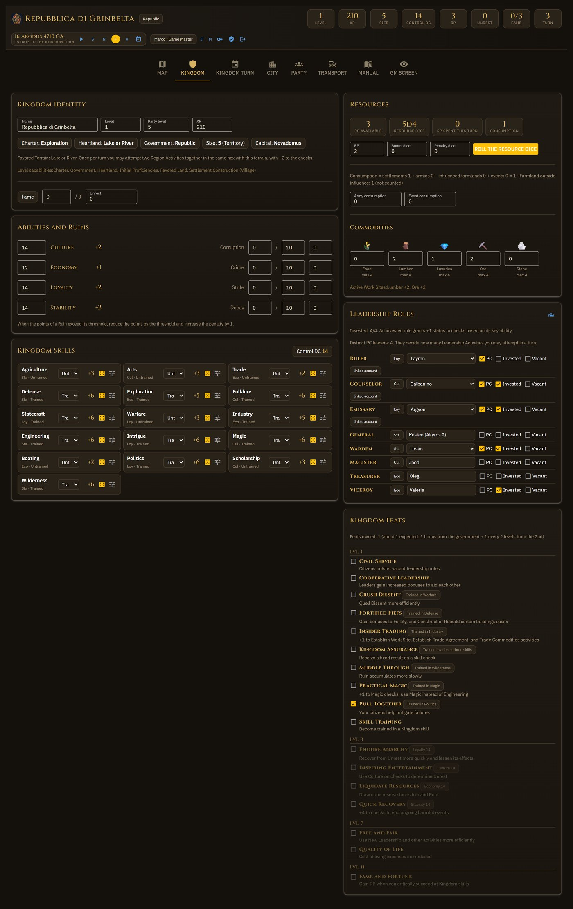
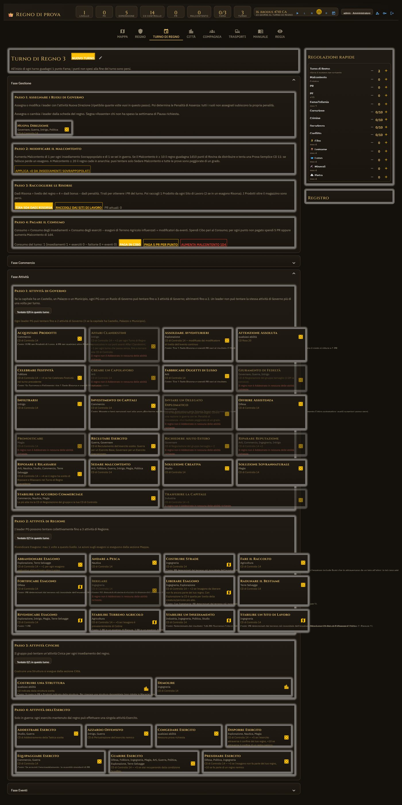
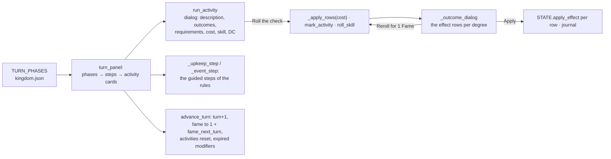
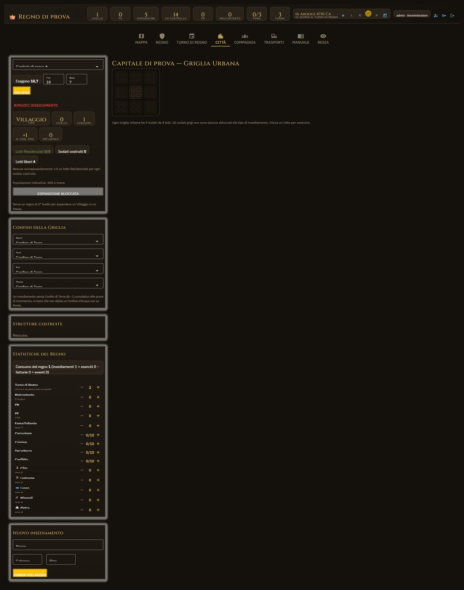

# 5. Kingdom, Kingdom Turn, City

## The rules: `rules/__init__.py` and `rules/data/`

`rules/__init__.py` **contains no rules**: it loads the JSON and offers the computation. Every mechanics
file has its `_source`; the texts live apart, one folder per language.

| File | Content | Entries |
|---|---|---|
| `kingdom.json` | abilities, ruins, skills, charters, heartlands, governments, roles, proficiencies, size and level tables, settlement types, commodities, terrains, terrain features, `travel` (categories, costs, borders, current), milestone XP, unrest thresholds, turn phases | — |
| `activities.json` | the Kingdom Turn activities, with `phase`, `step`, `skills`, `dc`, and `effects` already translated into applicable entries per degree | 49 |
| `structures.json` | the Urban Grid structures: lots, cost, construction check, `kingdom_effects` (structured: kind, sign, quantity) | 76 |
| `feats.json` | the kingdom feats | 17 |
| `vehicles.json` | the vehicle catalogue with speeds, seats, kind | 45 |
| `calendar.json` | months, leap year, the leaders' downtime (read by `rules/almanac.py`) | — |
| `lang/en/*.json`, `lang/it/*.json` | the texts of every entry above, keyed by id: names, descriptions, outcomes, requirements, notes | — |

`tools/split_texts.py` made the split once; `rules.merge_texts` puts the halves back together
at load, English first so a hole in a language shows the English text. `rules.data(lang)`
builds the tables once per language and `rules.View` hands the panels the table of the current
window (chapter 4). `tools/check_data.py` verifies that the two languages have the same shape
and that every id referenced by the mechanics exists.

`BY_ID[kind][id]` is the index for everything. The functions that count: `roll_check` (d20,
degree of success with natural 1 and 20), `success_grade`, `grade_label` (in the viewer's
language), `signed_value` («-1d6» → number and description), `entry_label` (how an effect
reads), `structure_effects` (the structured effects of a structure, which release 0.9 used to
parse from the Italian prose).

## The derived state: `state.State`

`STATE` is the single instance. Besides holding `k`, it computes what the sheet shows:

| Property/method | Rule |
|---|---|
| `size_` | `claimed` hexes |
| `control_dc` | level table + size modifier + 2 if the Ruler is absent |
| `skill_detail(sid)` | ability, proficiency, the status bonus of the invested role (the best), Unrest penalty, Ruin penalty, temporary modifiers (the best per type) |
| `consumption()` | settlements + armies − influenced farmlands + events; `farms_outside` counts the claimed Farmland out of every influence, shown so that «farmland 0» with a field on the map explains itself |
| `influenced_hexes()` | claimed hexes within the influence of a placed settlement (`hexgrid.distance`): a village 0 (its own hex), a town 1, a city 2, a metropolis 3; 0 for a settlement bordered only by water without a bridge |
| `in_influence(col, row)` | the requirement of Establish Farmland, and the condition for Farmland to count |
| `farmland_ground(h)` | the other requirement: "plains" or "hills" when that is the predominant terrain (the first listed), None otherwise; no terrain set counts as plains. Cost and DC follow it |
| `farmland_partners(col, row, hills)` | the hexes that can take the second Farmland of a critical success: adjacent, claimed, in influence, no settlement or Farmland yet, plains (or hills, for an attempt in hills) |
| `step_limit(phase, step)` | Leadership: `max_leadership_activities × pc_leaders`; Region: 3; Civic: number of settlements |
| `activity_block(act)` | why an activity cannot be attempted: proficiency, per-turn limit, anarchy, step used up |
| `apply_effect(entry, value)` | the single point that modifies the kingdom by effect of an activity |
| `skill_detail(sid, activity, variant, hex_, settlement, event, fair)` / `check_detail` | the breakdown of a Kingdom check: `_modifiers` collects every source as (name, value, type) — ability, proficiency, invested leaders, Unrest, Ruin, the structures' item bonus, the vacancy penalties (`role_vacant`), the feats, Expansion Expert, the temporary modifiers — and the PF2e stacking keeps, per type (status, circumstance, item), the best bonus and the worst penalty; vacancy penalties stack. `event` ("ongoing", "defenses", "bickering") is for the feats that help on event checks; `fair=False` is Free and Fair's own reroll |
| `kingdom_check(sid, dc, activity, …)` | **every** check of the app rolls here: the breakdown, Anarchy's worsening, then what acts on the result — a one-check bonus used up (Focused Attention, `once` modifiers; Cooperative Leadership at 11th), Pull Together, a Fame point and Fame and Fortune's die on a critical. What a feat did goes into `Result.notes` |
| `assurance_available` / `assurance_result` | Kingdom Assurance: a chosen trained skill, once a turn, 10 + proficiency |
| `feat_choices`, `feat_turns`, `use_feat`/`feat_used` | the feats' choices and once-per-turn bookkeeping; `muddle_through(on)` moves the Ruin thresholds and takes them back exactly; `new_turn_feats` lowers Pull Together's DC |
| `feat_offers` / `take_feat_offers` | Crush Dissent (Unrest rising) and Liquidate Resources (an outcome not paid), offered by `theme._offer_feats` like the Fame ones |
| `check_milestones()` | run on every save: the milestones that follow from the kingdom as it is (Landmark/Refuge on a claimed hex, size, settlement types, eight leaders, 100 RP); the diplomatic and trade ones come from the `milestone` effects of their activities |
| `item_bonus(activity, skill, variant, hex_, settlement)` | from the `item_bonuses` of `structures.json`: the capital's structures help everywhere, another settlement's only in the claimed hexes of its influence (`influence_of`) or when the table attempts the activity there; identical structures stack up to the settlement's `item_bonus_max`, different ones do not (the best counts). `skills` limits an entry to some skills (Rest and Relax using Scholarship), `variant` to what the activity makes (a lumber camp) |
| `fame_from_structure(sid)` | a famous/infamous structure built: +1 point if the trait is the kingdom's, −1 if it is the opposite one |
| `spend_fame()` | 1 point, for a reroll |
| `fame_offers` / `take_fame_offers()` / `stave_off(offer)` | `modify_unrest` reaching Anarchy and `modify_ruin` raising a penalty, with points in hand, leave an offer; `stave_off` spends all the points and holds Unrest 1 below Anarchy, or the Ruin at its threshold with the penalty as it was |

`pc_leaders()` counts **distinct characters** (`character_id`), not names: two roles of the
same PC count as one.

**What the turns remember (2.3.0).** `kingmaker/turn_memory.py` holds pure functions over
`k["turn_memory"]`: `record` (who attempted what, trimmed to three turns by `new_turn`), `last`
(the turn each activity was last attempted: the repeat rules read this), `streaks`
(Clandestine Business), `lockouts` (`{act, subject, until_turn}`), `debts` (Tap Treasury),
`penalties` (`{role, scope, value, phase, clears_on}`) and `pending` (the delayed flat checks).
Every structure but `record` is written by an outcome row and never rebuilt from the record, so
trimming cannot lose a lock-out. On `State`:

| Method | Rule |
|---|---|
| `activity_dc(act, subject, base, extra)` | **the** DC of an activity, used by the Turn tab, the map and the city: the Control DC or the written one, plus `repeat_dc` when attempted last turn, `streak_dc`, a partner's Negotiation DC (`special`; foreign aid +2; an agreement the higher of the two). Returns `(dc, breakdown)` |
| `mark_activity(act, role, character, settlement, hex_, skill, subject)` | counts the activity (`turn_activities`, `turn_leaders`, `turn_civic`), bumps the streak and writes the record |
| `activities_block(act, leader, subject, settlement)` | `_block_reason` (proficiency, per-turn limit, anarchy, step used up, a leader's two or three activities and no repeat, one Civic per settlement with Civic Planning) then `lockout_reason`; the dialog offers the GM an override of a lock-out only |
| `worsens_by(act, subject)` | Tap Treasury's debt (2 degrees), an envoy to an enemy (1) |
| `apply_effect(entry, value, target, ..., context)` | the new kinds `lockout`, `pending_check`, `event_mark`, `debt`, `repay`, `penalty`, `unclaim`, `claim`, `relation`, `agreement` go through `_apply_marker`: they carry no number (`_NO_VALUE`) and read the activity's subject, hex and settlement from `context` |
| `new_turn_memory()` | called by `advance_turn`: trims, drops expired lock-outs and penalties |
| `ongoing_events`, `event_dc`, `due_checks`, `clear_pending` | the events of `k["events"]` and the pending checks, rolled from `ui/tabs/events.py` |
| `secondary_hexes()` | claimed hexes not connected to the capital's hex (a BFS), derived, never stored: −4 through `_modifiers(hex_=…)`, 1 Unrest at Upkeep |
| `unclaim_hex`, `claim_freehold` | a lost or abandoned hex (its settlement kept in the freehold feature's `settlement_data`) and Pledge of Fealty bringing it back (`kingmaker/settlements.new_settlement` for one never the kingdom's) |
| `partner`, `relation`, `at_war`, `active_agreements` | diplomacy: `k["partners"]`, `k["diplomatic_relations"]`, `k["trade_agreements"]` |

`_modifiers` also adds the active penalties (a failed New Leadership's −1, the vacancy penalty
taken for a leader who did not rest), the envoy's +2 with one partner, the +1 to Trade
Commodities while diplomatic relations stand (`related_partners`) and −1 per settlement with no land border. Request Foreign Aid's RP are
counted in `rp_no_xp`, which `_convert_rp` leaves out.

## The Kingdom sheet — `ui/tabs/sheet.py`

*The Kingdom sheet: identity, abilities, skills, resources, leadership roles, feats.*

Refreshable blocks registered at the bottom of the module (`_name`, `_ref` in a loop):
identity, abilities, skills (rollable with `roll_skill` → `theme.show_result`), roles,
resources, feats. **Roles are assigned to a character** (`ui.select` on the characters of the
campaign) when `pc` is ticked; otherwise to a free name for the NPCs. `characters_dialog` is the
character management seen from here (create, link to an account, delete).

## The Kingdom Turn — `ui/tabs/turn.py`

*The Kingdom Turn: the phases, the activities per step, the journeys under way, the journal.*

- `run_activity` shows the breakdown with `check_detail`, the structures' item bonus included.
  When a settlement other than the capital has a structure that helps the activity
  (`bonus_settlements`), an *Attempted in* choice says where it is attempted.
- `_outcome_dialog(act, res, reroll, rerolled)` offers the reroll for 1 Fame/Infamy point while
  `theme.can_reroll` allows it: the effects wait on that screen anyway, so the reroll replaces
  the outcome, once.
- `only_if: "fame"` / `"no_fame"` on an effect entry ticks it by the points in hand (a
  Masterpiece's critical failure: lose 1 point, or 1d4 Unrest if there is none). `fame_next`
  owes points for the next turn (`k["fame_next_turn"]`), which `advance_turn` adds.

- `_activity_dc`: a thin wrapper of `STATE.activity_dc`.
- `run_activity` asks for the activity's **subject** (`_subject_options`: an event, a Ruin, a
  partner), the **leader** of a Leadership activity (`_leader_options`) and the freehold of
  Pledge of Fealty; the DC, the cost (`activity_cost`: Hire Adventurers' 2 Resource Dice after a
  failure) and the modifiers (`activity_extra`) redraw when they change. `propose_rows(title,
  entries, skill, context, …)` is the shared dialog of effect rows that the map, the city and
  the events also use.
- `ui/tabs/events.py` draws the ongoing events (`ongoing_list`, `check_dialog`,
  `outcome_dialog`) and the pending checks (`pending_block`) in the Event phase;
  `ui/tabs/leaders.py` the downtime ticks of the roles step (`downtime_block`) and the Loyalty
  check of a failed New Leadership; `ui/tabs/diplomacy.py` the Diplomacy block of the sheet.
- `_commerce_step` gives the Commerce phase its body: the DC 11 flat check when nobody collected
  taxes, the agreements in force. `_ruin_split_dialog` splits Unrest 10's 1d10 Ruin points.
- `_effect_rows(entries)` draws every entry as a tickable row with an editable value; dice are
  rolled on the spot (`rules.signed_value`). `entry_target` asks whom to apply it to («ruin of
  your choice», «commodity of your choice»).
- `quick_adjustments`: the manual sliders for when the rules leave the table to decide.
- **`advance_turn` does not touch the interface**: the clock calls it too at the end of the
  month (chapter 10), from a timer where there is no window to notify.
- `journeys_in_progress` / `_resolve_journey`: the journeys departed from the map are resolved
  by hand from here (chapter 8). A player's list holds only the journeys with a character on
  the map for them (`view.MapView.sees_journey`, the rule the map draws routes by), and the
  journal (`_journal`) shows the `account` lines only to whoever manages accounts (2.2.0).

## The Cities — `ui/tabs/city.py`

*The Cities: the settlement's urban grid, the structures, the consumption.*

A settlement is `city.new_settlement`: `grids` (one or more, each 9 blocks × 4 lots, holding
structure **ids**), `active_blocks`, `borders` (north/south/east/west: land or water, for the
Bridge), `capital`, `hex`. The Urban Grid is drawn by `_draw_grid`; clicking a free lot opens
`_construction_dialog`, which lists the affordable and contiguous structures
(`_free_contiguous_lots`).

`_build` is the complete sequence of the rule: pay the cost, roll Build a Structure with the
best of the allowed skills (with the item bonus of the settlement's and the capital's
structures), place (or Rubble on a critical failure), move the Fame/Infamy points of a famous
or infamous structure, then `_effects_dialog` proposes Unrest and Ruins from the structured
effects. The roll goes through `theme.show_check`, so the reroll for Fame comes before any of
it; *Place without a check* moves no points. `_can_expand` / `_expand` follow the table
of the settlement types (village → town → city → metropolis).

From 2.3.0 `_build` takes a `cost` (`build_cost`: half with a Ruins feature on the hex, nothing
for a failed construction retried, `retry_free`), a `replace_gid` (an upgrade: `upgrade_cost`
is the difference of the two costs, `upgrade_room` the block's space) and `repairing` (half the
cost, +2 item, a critical failure leaves Rubble). A lot carries `damaged`, `demolishing` and
`failed: {structure, turn}`; `structures_of` skips a structure being demolished, and an Edifice
counts once in `storage` and `item_bonus`. Demolish is a Civic check (`_demolish`,
`demolish_result`). Walls and bridges stand on a border: `borders[side]` gains `wall` and
`bridge` (`_border_side_dialog`, `wall_sides`, `bridge_sides`), and the first wall of a kind
gives the −1 Unrest.

The city↔hex link is two-way: `STATE.link_settlement(sid, col, row)` writes `ins["hex"]` **and**
`h["settlement"]` and the terrain feature; `unlink_settlement` undoes everything. From the map
(`hexmap._settlement`, `_link_existing`) and from the city (`_position_block`) one goes through
the same two functions.

## The guided creation — `ui/tabs/creation.py`

The ten steps of the rules in a single page with a `draft`; `compute_scores` adds boosts and
flaws, `_found` writes the kingdom and the capital, and the page reloads. It appears only as
long as `STATE.k["created"]` is false.
